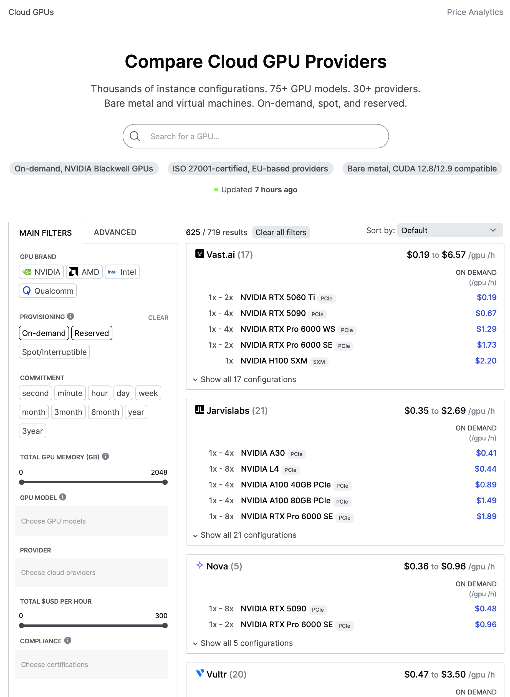
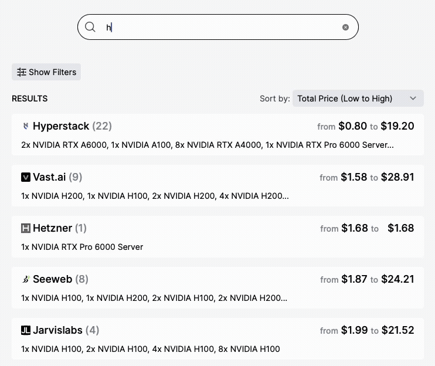
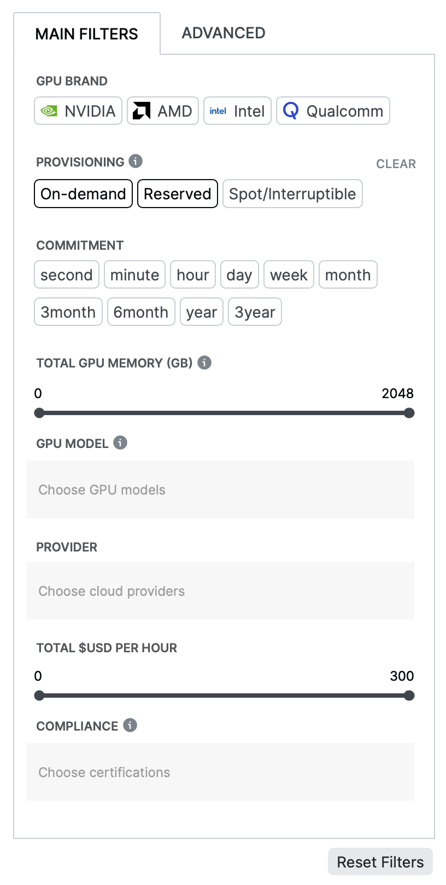
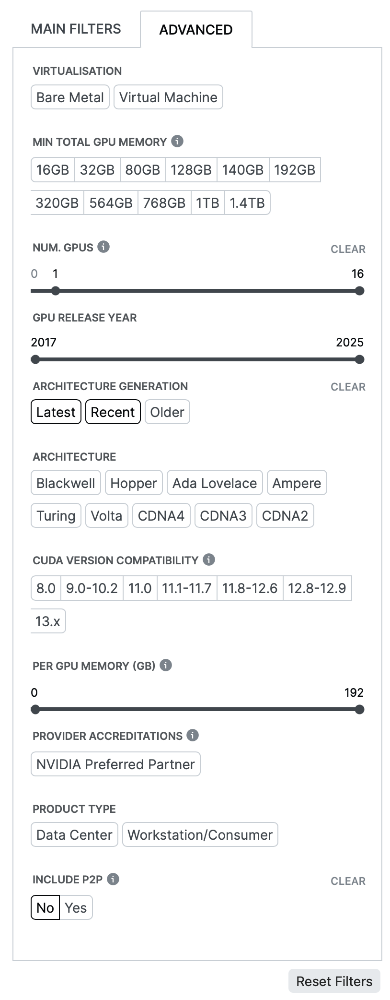
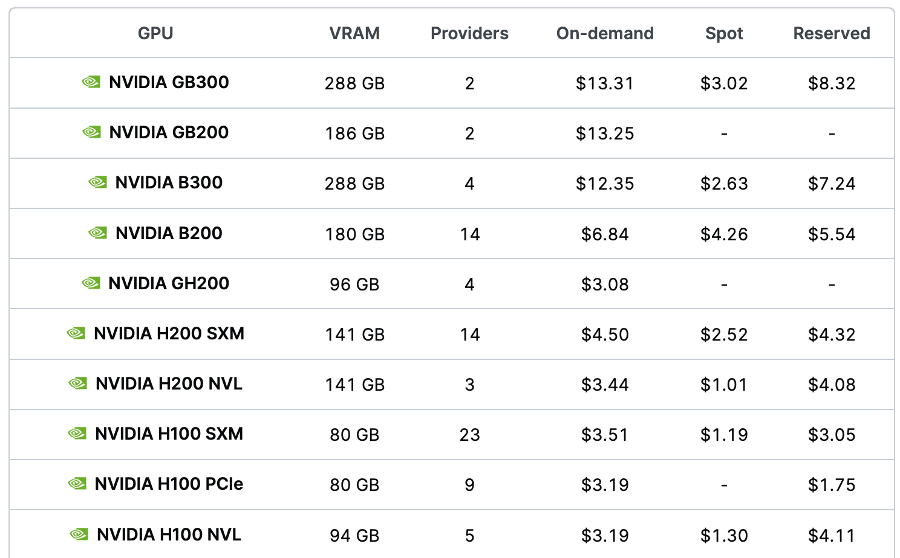
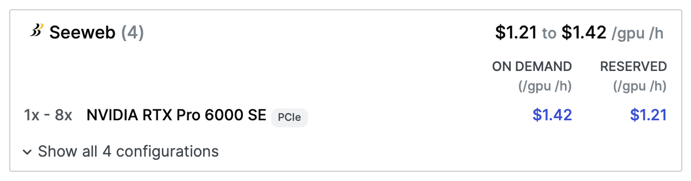
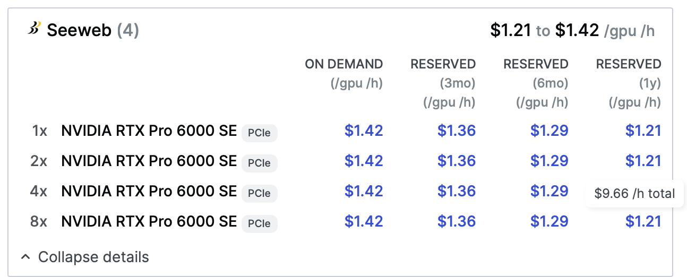

# Cloud-GPUs.com: a searchable database of cloud GPUs

[Cloud-GPUs.com](https://cloud-gpus.com) is a comparison site for cloud GPU instances.
It provides access to **a searchable database of over 5,000 GPU instance configurations across
30+ providers and 75+ GPU models**. Prices are updated at least daily for most providers.

## Instant search

Just start typing to **search** across the entire database of thousands of instance configurations.

  

## Filters

Narrow down the results list to only those you care about. 

**Select specific GPU models, individual cloud providers, total VRAM, hourly price, compliance certifications**, and more.

  
  

For example: filter down to [only instances with RTX PRO 6000 Blackwell GPUs](https://cloud-gpus.com/?provisioning=On-demand%2CReserved&gpu=RTX+Pro+6000+SE&num_pgus__lower=1&gen=Latest%2CRecent&p2p=No).

## Shareable URLs

To share or share a set of filtered results, bookmark the page's URL, or copy and share it. 

**All filters and search terms are stored in the link.**

For example:
- [Instances with RTX 4090 GPU(s)](https://cloud-gpus.com/?gpu=RTX+4090)
- [Instances with AMD GPUs](https://cloud-gpus.com/?brand=AMD)
- [Instances with 72GB+ total VRAM](https://cloud-gpus.com/?vram__lower=72) 
- [Spot instances with NVIDIA Blackwell GPUs](https://cloud-gpus.com/?provisioning=Spot%2FInterruptible&arch=Blackwell)
- [Only ISO 27001-certified, EU-based providers](https://cloud-gpus.com/?provisioning=On-demand&reg=EU%2CISO+27001)
- [Only GPUs compatible with CUDA 12.8 or 12.9](https://cloud-gpus.com/?cuda=12.8-12.9)

## Price Analytics

The [GPU Price Analytics page](https://cloud-gpus.com/price-analytics) provides **a digestible summary
of hourly pricing across all providers** for the most popular GPUs pricing for each GPU model, and is updated daily.

This page is useful for getting an overview of the GPU rental market as a whole. In the screenshot below,
the most expensive on-demand GPU is the NVIDIA GB300, with a median hourly price of $13.31.

## Database

The [Cloud-GPUs.com](https://cloud-gpus.com) database includes:
- Hyperscalers (AWS, Google Cloud Platform, Azure, Oracle)
- Other global cloud providers (Vultr, DigitalOcean, ...)
- AI-focused Neoclouds (CoreWeave, Lambda Labs, Nebius, Together AI, ...)
- Regional cloud providers (Hetzner, Atlantic.net, Beyond.pl, ...)
- Compute marketplaces (Vast.ai, Runpod, ...)

Data is refreshed at least daily for most providers.

## Comparing instances details and prices

The results panel shows a summary of available instances. 

Clicking on "Show all configurations" expands a provider's results panel to show a more detailed view, with each
available configuration showing as a separate line. 

This example shows four instance configurations available at the cloud provider Seeweb.it, with hourly gpu prices
ranging from $1.23/h to $1342/h. 
The first configuration has one NVIDIA RTX Pro 6000 Server
GPUs attached, the second has two, the third four, and the fourth eight. All have pricing starting at $1.23/gpu/h for 1-year reservations.

The following info is also shown:
- The interface on the GPU is PCIe
- The $1.21/gpu/h price is for a 1-year reservation. 6- and 3-month reservations are slightly more expensive, and on-demand prices are $1.42/h. 
- The total hourly price for the 8x NVIDIA RTX Pro 6000 Server configuration is $9.66. (this shows up when hovering over per-gpu hourly prices)

On larger screens more columns would be shown, including total VRAM, memory bandwidth, available regions, and other instance specs.

# About

Cloud-GPUs.com is one of the longest-running cloud GPU comparison portals.
The original version, created by Harald Carlens, was a simple static website of listings
driven by a .json file hosted in this repo.

In late 2025, Harald relaunched Cloud-GPUs.com with new interactive features and a daily data update process.
These new features help users to search across thousands of GPU instances and dozens of providers to compare the latest
prices and offerings.

Cloud-GPUs.com has been cited in
[The Verge](https://www.theverge.com/ai-artificial-intelligence/822011/coreweave-debt-data-center-ai),
[Cambridge University Press publications](https://www.cambridge.org/core/journals/flow/article/fast-monotonically-integrated-large-eddy-simulation-solver-validation-of-a-new-scalable-tool-to-study-and-optimize-indoor-ventilation/ED8DF2399644ACBC52FB83046768F4B6),
[DataCenter Knowledge](https://www.datacenterknowledge.com/ai-data-centers/neoclouds-vs-hyperscalers-will-ai-s-specialized-clouds-prevail-),
the [Answer.ai blog](https://www.answer.ai/posts/2024-03-06-fsdp-qlora.html),
and [Kerrisdale Capital's research notes](https://www.kerrisdalecap.com/wp-content/uploads/2025/09/Kerrisdale-CoreWeave.pdf).

Along with Cloud-GPUs.com, Harald also runs mlcontests.com (a directory for machine learning competitions and related
research) and writes for joltml.com (an online magazine covering machine learning research and conferences).
